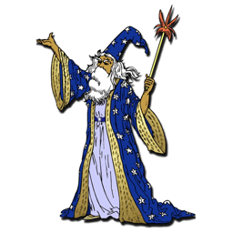
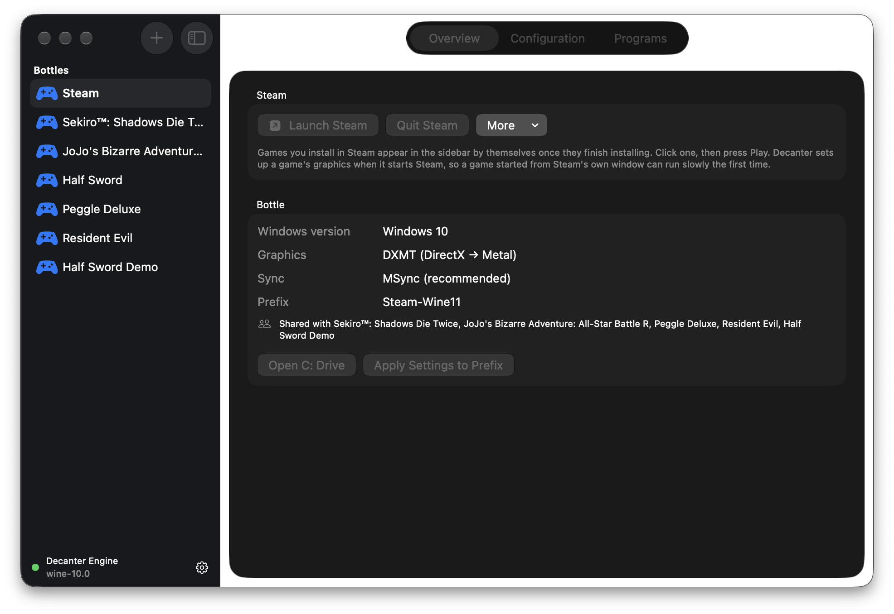
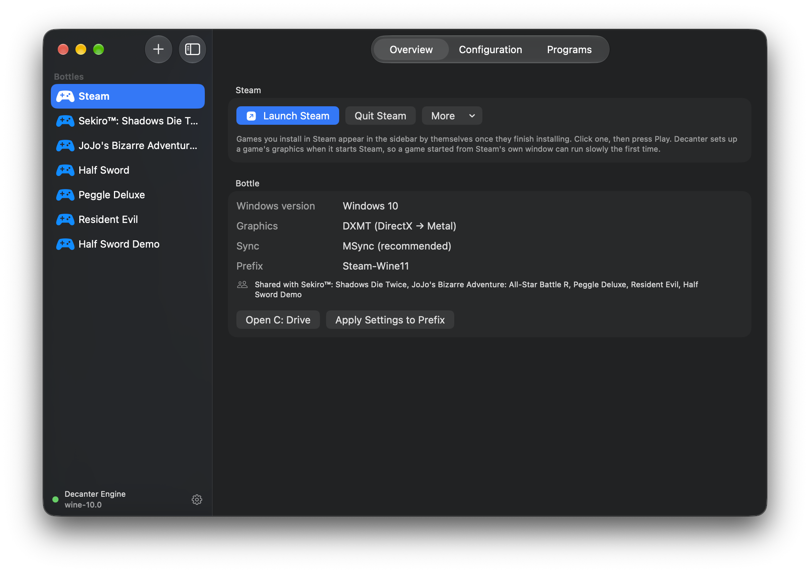

<p align="center">
  
</p>

<h1 align="center">Decanter</h1>

<p align="center">
  <b>Play Windows games from Steam on an Apple silicon Mac — free, with one button.</b>
</p>

<p align="center">
  <a href="https://github.com/jackpetersen235-jpg/decanter/releases/latest"></a>
  
  <a href="LICENSE"></a>
</p>

<p align="center">
  
</p>

Decanter sets everything up itself — Apple's Rosetta, a Windows engine tuned for games, and
Steam. Install a game in Steam and it appears in Decanter's sidebar with a **Play** button.
It's free and open source, built for gaming on current macOS in the spirit of
[Whisky](https://github.com/Whisky-App/Whisky), which is no longer developed.

**[Download Decanter](https://github.com/jackpetersen235-jpg/decanter/releases/latest)** ·
[Report a problem](https://github.com/jackpetersen235-jpg/decanter/issues/new?template=bug_report.yml) ·
[Discussions](https://github.com/jackpetersen235-jpg/decanter/discussions)

## Install

1. Download **Decanter-‹version›.zip** from the
   [latest release](https://github.com/jackpetersen235-jpg/decanter/releases/latest) and open it.
2. Drag **Decanter** into your Applications folder.
3. Open it once: double-click it, click **Done** on the warning, then go to
   **System Settings → Privacy & Security** and click **Open Anyway**. Decanter isn't
   notarized by Apple yet, so macOS asks you to approve it once.
4. Press **Set everything up for me**. It downloads about 500 MB and takes a few minutes.
5. Click **Launch Steam**. The first time, Steam downloads itself before any window appears;
   Decanter shows how far along it is. Sign in and install a game.
6. Switch back to Decanter. When the game finishes installing, it appears in the sidebar by
   itself. Click it and press **Play**.

After that Decanter updates itself: when a new version is out, an update button appears at the
bottom of the sidebar, or choose **Decanter ▸ Check for Updates…**.

## What you need

- A Mac with Apple silicon (M1 or later). Intel Macs aren't supported.
- macOS 14 or later. Tested most on macOS 26 and 27.
- About 2 GB of free space, plus room for your games.

## Three looks

Decanter opens in **Liquid Glass** (above). In **Decanter ▸ Settings… ▸ Theme** you can switch
to **Standard**, the plain macOS look (below, in dark mode), or **Frutiger Aero**, with glossy
2006-era buttons and a painted sky.

<p align="center">
  
</p>

## What runs, and what doesn't

- **DirectX 10 and 11 games** run through DXMT, which translates them straight to Metal. Any
  game can be switched to DXVK or Wine's own renderer in its **Configuration** tab.
- **DirectX 12 games** need Apple's D3DMetal, which isn't part of Decanter's engine. They run
  only if you point a bottle at a CrossOver or Game Porting Toolkit engine you already have.
- **Games with kernel-level anti-cheat** (Valorant and most competitive shooters) don't run.
  No Mac tool can run them.
- **Demanding 3D games** run slower than on a gaming PC. Keep your Mac plugged in while playing.
- Tested most heavily on *Sekiro: Shadows Die Twice* on an M5 MacBook Air. Tell everyone
  what works for you in [Discussions](https://github.com/jackpetersen235-jpg/decanter/discussions).

## Found a bug?

In Decanter, choose **Help ▸ Report a Problem…**. It opens a bug report on GitHub with your
version, your Mac and a diagnostic report already filled in. Your home folder's name is taken
out of the report, and nothing is sent until you read it over and press **Create**. You'll
need a free GitHub account.

Questions, ideas and "this game works!" go in
[Discussions](https://github.com/jackpetersen235-jpg/decanter/discussions).

## What's inside

A Windows game on an Apple silicon Mac runs through a chain of translators. Decanter installs,
tunes and drives all of them:

```
Windows game (x86-64, DirectX 10/11)
     │  Wine 10 + msync    Windows API   → macOS
     │  Rosetta 2          x86-64 code   → Apple silicon
     ▼  DXMT               DirectX 10/11 → Metal
```

- **The engine** is upstream Wine 10.0 with **msync**, fast thread synchronisation — the
  difference between smooth play and frame spikes. It's downloaded at first run and its
  checksum verified.
- **A patched DXMT ships inside the app.** Stock DXMT 0.80 freezes for about 26 seconds at a
  time in games that use geometry shaders; Decanter's build fixes that
  (see [`Assets/DXMT/VERSION.txt`](Assets/DXMT/VERSION.txt)).
- **Every game gets its own settings** — graphics, Windows version, Retina, upscaling — while
  sharing one Steam install.
- **Real game window** (optional, per game) runs the game as a proper macOS game, so macOS
  Game Mode turns on.
- **GPU keep-alive** (optional) works around a fault in Apple's GPU firmware that freezes some
  Macs for about 7 seconds at a time.

Already have Wine? Decanter also finds Whisky, CrossOver and Game Porting Toolkit engines, or
any Wine `bin` folder you add in Settings.

## Build from source

```bash
git clone https://github.com/jackpetersen235-jpg/decanter.git
cd decanter
Scripts/make_app.sh       # builds build/Decanter.app (universal; needs Xcode)
open build/Decanter.app
```

- Swift Package Manager and SwiftUI, macOS 14+. With only the Command Line Tools,
  `NATIVE_ONLY=1 Scripts/make_app.sh` builds for your Mac's architecture alone.
- Tests: `swift test`, or `bash Scripts/test-shim/run-tests.sh` where XCTest isn't available.
- Support flags on the app's binary: `--verify` (health check), `--diagnose`, and
  `--problem-report` (prints the bug-report link instead of opening it).
- [`docs/GAMING-STACK.md`](docs/GAMING-STACK.md) explains the engine choices and the dead ends;
  [`CLAUDE.md`](CLAUDE.md) and the rest of [`docs/`](docs) are the project's working notes.

Pull requests are welcome. For anything big, start a Discussion first.

## Thanks

Decanter stands on [Wine](https://www.winehq.org), [DXMT](https://github.com/3Shain/dxmt) by
Feifan He, [DXVK](https://github.com/doitsujin/dxvk),
[MoltenVK](https://github.com/KhronosGroup/MoltenVK), and
[Whisky](https://github.com/Whisky-App/Whisky) by Isaac Marovitz — the original idea, and,
through [frankea/Whisky](https://github.com/frankea/Whisky), the engine's support libraries.
The msync Wine build comes from the [Sikarugir](https://github.com/Sikarugir-App) project.

## License

Decanter is free and open source under the **GNU General Public License v3.0** — see
[`LICENSE`](LICENSE). Copyright © 2026 Jack Petersen.

Decanter also installs and runs third-party software under its own licenses: the Wine engine
its setup downloads (Wine is LGPL 2.1; DXVK, MoltenVK and the rest are listed in
[`THIRD-PARTY-NOTICES.md`](THIRD-PARTY-NOTICES.md)), and the patched DXMT DLLs bundled in the
app (MIT — [`Assets/DXMT/LICENSE`](Assets/DXMT/LICENSE)). Steam is downloaded from Valve's
official CDN and is covered by Valve's own terms.

Decanter isn't affiliated with Valve, Apple or CodeWeavers. Steam is a trademark of Valve
Corporation.
